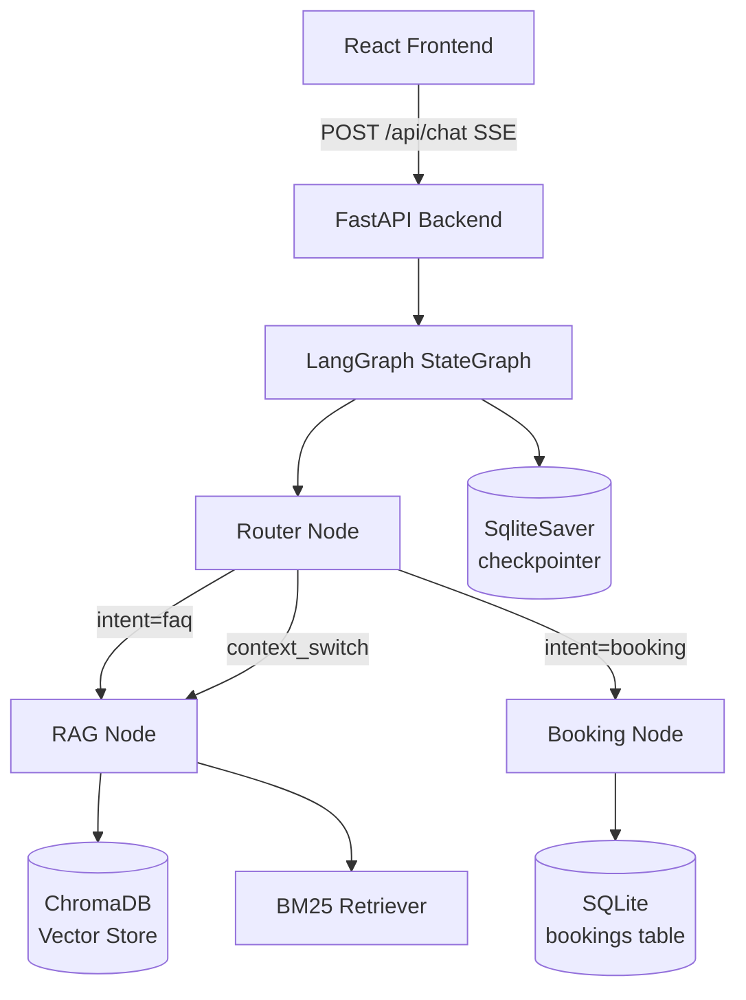

# Agentic HR Assistant

A full-stack conversational AI that answers HR policy questions via RAG and books appointments through multi-turn dialogue — with a live agent control room UI.

## Architecture



## Features

| # | Feature | Description |
|---|---------|-------------|
| 1 | **Live Agent Control Room** | Real-time execution timeline showing Router → RAG/Booking steps with status badges |
| 2 | **Booking Copilot with Human Approval** | Slot card UI → user selects → confirms → DB write. Prevents double-booking. |
| 3 | **Trustworthy RAG with Evidence** | Every answer cites `(Doc, Page X)`. Clickable snippet previews. Low-confidence abstention. |
| 4 | **Context Switching** | FAQ mid-booking returns to booking state without losing name/email/slot |
| 5 | **Prompt Injection Protection** | Pattern-based injection detection, email validation, PII masking in logs |
| 6 | **Agent Evaluation Lab** | In-UI dashboard: run test suite, view pass/fail per category with metrics |
| 7 | **Persistent Conversations** | SqliteSaver checkpointer — state survives backend restarts. Thread sidebar with rename/delete. |
| 8 | **Document Management Panel** | Upload new PDFs, view chunk/page stats, test retrieval queries live |

## Tech Stack

| Layer | Technology |
|-------|-----------|
| Agent Framework | LangGraph 1.2 (StateGraph, AsyncSqliteSaver checkpointer) |
| Backend | Python 3.11 · FastAPI (async) · SSE streaming |
| LLM | Groq API — qwen/qwen3-32b (free & fast; configurable) |
| Vector Store | ChromaDB (local, persisted) |
| Embeddings | sentence-transformers all-MiniLM-L6-v2 (free) |
| Retrieval | Hybrid: BM25 (rank-bm25) + ChromaDB vector search |
| Frontend | React 18 · Vite · Tailwind CSS |
| Database | SQLite (bookings table + LangGraph AsyncSqliteSaver) |

## Local Setup

### Prerequisites
- Python 3.10+
- Node.js 18+
- Groq API key (free at [console.groq.com](https://console.groq.com))

### Backend

```bash
cd agentic-hr-assistant

# Create and activate virtualenv
python -m venv venv
# Windows:
venv\Scripts\activate
# macOS/Linux:
source venv/bin/activate

pip install -r backend/requirements.txt

# Create .env from template
cp .env.example .env
# Edit .env and add your GROQ_API_KEY

# Run backend (set BACKEND_PORT=8080 in .env if 8000 is blocked)
cd backend
uvicorn main:app --reload --host 0.0.0.0 --port 8000
```

The backend will:
1. Initialize SQLite tables and seed 10 appointment slots
2. Download and ingest both PDFs in the background (first start takes ~60s)
3. Stream SSE events on `POST /api/chat`

### Frontend

```bash
cd frontend
npm install
npm run dev
# Opens at http://localhost:5173
```

### Docker (optional)

```bash
docker-compose up --build
# Backend: http://localhost:8000
# Frontend: http://localhost:5173
```

## API Reference

| Method | Endpoint | Description |
|--------|----------|-------------|
| `POST` | `/api/chat` | SSE streaming chat (message + thread_id) |
| `GET` | `/api/slots` | Available appointment slots |
| `GET` | `/api/threads` | List conversation threads |
| `DELETE` | `/api/threads/{id}` | Delete a thread |
| `PATCH` | `/api/threads/{id}` | Rename a thread |
| `GET` | `/api/threads/{id}/messages` | Message history from checkpointer |
| `GET` | `/api/threads/{id}/booking` | Active booking for a thread |
| `GET` | `/api/docs` | List indexed documents |
| `POST` | `/api/docs/upload` | Upload and index a new PDF |
| `POST` | `/api/docs/preview` | Preview retrieval for a query |
| `POST` | `/api/docs/query` | Alias for /api/docs/preview |
| `POST` | `/api/eval/run` | Run the evaluation suite |
| `GET` | `/api/health` | Health check |

## Sample Dialogue — Context Interleaving

```
User:  I want to book a performance review
Bot:   I'd be happy to help! Could you provide your full name and email?

User:  Alex Chen, alex@company.com
Bot:   Thanks Alex! Here are available slots: [slot cards]

User:  Wait — how many vacation days do I get?    ← FAQ mid-booking
Bot:   Per the Employee Handbook (Page 14), employees receive 15 days PTO...
       [Returning to your appointment booking...]

User:  Let's go with Tuesday 11 AM (s3)
Bot:   Summary: Alex Chen · alex@company.com · Tuesday 11 AM. Confirm?

User:  Yes, confirm
Bot:   ✓ Booking confirmed! Reference: #REV-4821
```

LangGraph preserves `name`, `email`, `booking_status="slot_selection"` across the FAQ detour.

## Evaluation Suite

```bash
# Run deterministic tests (no LLM required for most)
python -m backend.tests.eval_runner

# Or via API (also runs in-UI via Eval Lab tab)
curl -X POST http://localhost:8000/api/eval/run
```

Test categories: Security · Input Validation · Database · Intent Routing

## AI Engineering Log

### Tools Used
- **Claude (Anthropic)** — architecture design, LangGraph graph wiring, SSE streaming logic
- **GitHub Copilot** — inline completions for boilerplate
- **Cursor** — refactoring node handlers

### Where LLMs Hallucinated and How I Fixed It

1. **LangGraph streaming API**: Claude initially suggested `graph.stream()` for SSE output, but this is synchronous and blocks the async event loop. Fixed by using `graph.astream_events(version="v2")` with `async for`, translating `on_chain_end` events (with `metadata["langgraph_node"]`) into SSE tokens.

2. **AsyncSqliteSaver initialization**: LLM generated `AsyncSqliteSaver.from_conn_string(path)` which doesn't exist in LangGraph 1.2. Correct API is `await aiosqlite.connect(path)` then `AsyncSqliteSaver(conn)`.

3. **ChromaDB confidence scores**: Claude assumed relevance scores are 0–1, but ChromaDB L2 distance conversion yields 0–0.6 for typical documents. Set `RAG_CONFIDENCE_THRESHOLD=0.3` instead of default 0.7 to avoid over-abstention.

4. **Duplicate token emission**: `on_chain_end` fires 2–3 times per node in LangGraph 1.x. Fixed by tracking `emitted_end_nodes: set` and skipping duplicate end events per node.

5. **Booking state reset**: First router iteration reset `booking_status` to `None` on context switch. Fixed by using `**state` spread so router only overrides `intent` / `current_node` / `streaming_events`, preserving all booking fields.

6. **Groq model availability**: LLaMA 3.3-70b-versatile was not available on this Groq account. Fell back to `qwen/qwen3-32b` which is available and performant.

7. **BM25 + vector ensemble**: Initial suggestion passed `VectorStoreRetriever` without score normalization. Added manual BM25/vector score merge with deduplication by document ID to avoid double-counting chunks.

## Verification Artifacts

Screenshots (see `screenshots/` directory):
- `screenshots/chat-rag.png` — RAG answer with citation badge and evidence snippets
- `screenshots/booking-flow.png` — slot selection cards → pending confirmation → confirmed
- `screenshots/context-switch.png` — FAQ mid-booking, state preserved across turns
- `screenshots/agent-timeline.png` — live Agent Control Room showing Router → RAG steps
- `screenshots/eval-dashboard.png` — Eval Lab UI showing 11/11 tests passing
- `screenshots/thread-sidebar.png` — persistent conversation threads with rename

### Verified Behaviors

| Behavior | Evidence |
|----------|----------|
| SqliteSaver restart persistence | Killed uvicorn, restarted, `GET /api/threads/persist-test-01/messages` returned 9 messages |
| Eval suite 100% | `python tests/eval_runner.py` → `Pass rate: 100.0% (11/11 tests)` |
| Context switching | Mid-booking FAQ returns answer then "Returning to your appointment booking..." |
| Citation abstention | Low-confidence queries return "Handbook doesn't contain enough information" |
| Double-booking prevention | `is_slot_available()` checked before `create_booking()` write |
